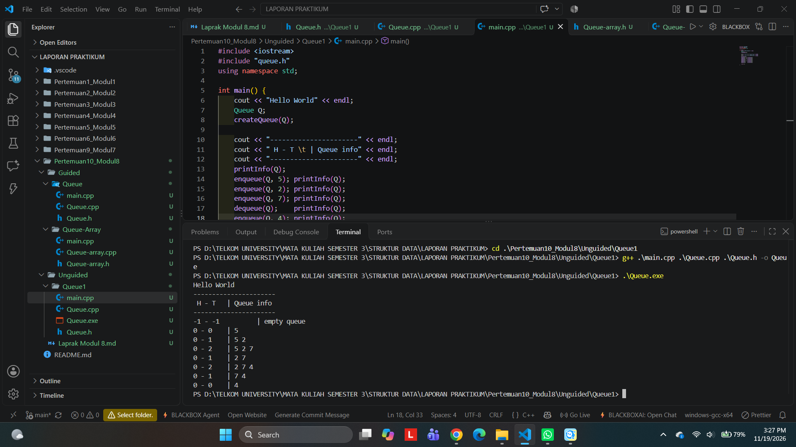
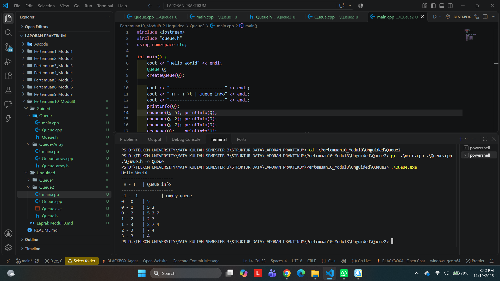
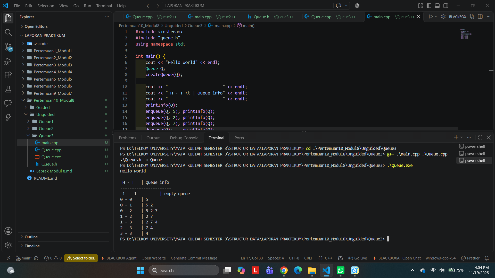

# <h1 align="center">Laporan Praktikum Modul 8 - Queue</h1>
<p align="center">Andhika Nur Pratama - 109082500056</p>

## Dasar Teori
<div align="justify">Queue merupakan salah satu struktur data linear yang menggunakan prinsip FIFO (First In First Out), yaitu elemen yang pertama kali dimasukkan akan menjadi elemen pertama yang dikeluarkan. Queue memiliki dua bagian utama, yaitu Head sebagai penunjuk elemen paling depan dan Tail sebagai penunjuk elemen paling belakang. Operasi utama pada queue terdiri dari Enqueue, yaitu proses menambahkan elemen baru pada bagian belakang antrean, serta Dequeue, yaitu proses menghapus elemen dari bagian depan antrean. Dalam implementasinya, queue dapat menggunakan struktur data array maupun linked list. Implementasi menggunakan linked list memanfaatkan pointer untuk menghubungkan setiap elemen sehingga jumlah data dapat bertambah atau berkurang secara dinamis melalui proses alokasi dan dealokasi memori. Sementara itu, implementasi menggunakan array menyimpan elemen berdasarkan indeks dengan kapasitas yang telah ditentukan. Salah satu pengembangan queue berbasis array adalah Circular Queue, yaitu mekanisme antrean yang memungkinkan posisi Head dan Tail bergerak secara melingkar dari indeks terakhir kembali ke indeks awal sehingga ruang kosong akibat penghapusan elemen dapat digunakan kembali tanpa perlu menggeser seluruh elemen [1][2]. Selain itu, queue dapat diterapkan menggunakan konsep Abstract Data Type (ADT) yang menyediakan operasi seperti CreateQueue, isEmpty, isFull, Enqueue, Dequeue, dan PrintInfo untuk mengelola data secara terstruktur. Dalam sistem komputer, queue banyak digunakan untuk mengatur urutan pemrosesan data, penjadwalan proses menggunakan algoritma First Come First Served (FCFS), pengelolaan paket data jaringan, serta sistem antrean pelayanan [1][3].</div>

### A. Pengertian Queue<br/>

#### 1. Definisi Queue
Queue merupakan salah satu struktur data linear yang menggunakan prinsip FIFO (First In First Out), yaitu elemen yang pertama kali dimasukkan akan menjadi elemen pertama yang dikeluarkan. Struktur data ini memiliki konsep yang menyerupai antrean dalam kehidupan sehari-hari, seperti antrean pembelian tiket dan antrean pelayanan. Prinsip FIFO digunakan untuk memastikan setiap elemen diproses berdasarkan urutan kedatangannya [1].
#### 2. Head dan Tail
Head merupakan penunjuk elemen paling depan dalam antrean yang menjadi posisi penghapusan data, sedangkan Tail merupakan penunjuk elemen paling belakang yang menjadi posisi penambahan data. Kedua komponen tersebut berperan penting dalam menjaga urutan elemen selama proses penambahan dan penghapusan berlangsung. Dalam implementasi menggunakan linked list, Head dan Tail direpresentasikan menggunakan pointer yang menunjuk ke node pertama dan node terakhir [1].
#### 3. Karakteristik Queue
Queue memiliki karakteristik utama berupa prinsip FIFO, proses penambahan elemen pada bagian belakang, dan penghapusan elemen pada bagian depan. Selain itu, Queue memiliki kondisi kosong ketika tidak terdapat elemen yang tersimpan di dalamnya. Pada implementasi berbasis array dengan kapasitas terbatas, Queue juga memiliki kondisi penuh ketika seluruh ruang penyimpanan telah digunakan.

### B. Operasi Dasar Queue<br/>

#### 1. Enqueue
Enqueue merupakan operasi untuk menambahkan elemen baru ke dalam Queue. Proses penyisipan dilakukan pada bagian belakang antrean atau Tail sehingga elemen yang sudah berada di dalam antrean tidak mengalami perubahan urutan. Pada implementasi linked list, proses ini dilakukan dengan membuat node baru, menghubungkan node terakhir dengan node tersebut, kemudian memperbarui posisi Tail [1].
#### 2. Dequeue
Dequeue merupakan operasi untuk menghapus dan mengambil elemen dari bagian depan antrean atau Head. Proses ini dilakukan dengan menyimpan elemen pertama, kemudian memindahkan posisi Head ke node berikutnya. Pada implementasi linked list, node yang telah dihapus perlu melalui proses dealokasi agar memori yang digunakan dapat dikembalikan kepada sistem. Operasi ini memastikan bahwa elemen yang pertama kali masuk akan menjadi elemen pertama yang dikeluarkan [1].
#### 3. Operasi Pendukung Queue
Selain Enqueue dan Dequeue, terdapat beberapa operasi pendukung yang digunakan untuk mengelola Queue, yaitu isEmpty untuk memeriksa apakah antrean kosong, isFull untuk memeriksa apakah antrean telah mencapai kapasitas maksimum, CreateQueue untuk membentuk antrean kosong, dan PrintInfo untuk menampilkan seluruh elemen yang tersimpan. Operasi pendukung tersebut membantu proses pengelolaan data agar berjalan sesuai dengan kondisi antrean.

### C. Implementasi Queue<br/>

#### 1. Queue Menggunakan Linked List
Linked list merupakan struktur data yang terdiri atas kumpulan node yang saling terhubung menggunakan pointer. Dalam implementasi Queue, setiap node memiliki bagian informasi untuk menyimpan data dan pointer next untuk menunjuk ke node berikutnya. Pengelolaan antrean menggunakan linked list memanfaatkan dua pointer utama, yaitu Head dan Tail. Penambahan elemen dilakukan melalui Tail, sedangkan penghapusan dilakukan melalui Head. Implementasi ini memungkinkan jumlah elemen bertambah atau berkurang secara dinamis melalui pengelolaan alokasi memori [1].
#### 2. Queue Menggunakan Array
Array merupakan struktur data yang digunakan untuk menyimpan sekumpulan elemen dengan tipe data yang sama pada indeks tertentu. Dalam implementasi Queue, array berfungsi sebagai tempat penyimpanan elemen, sedangkan variabel Head dan Tail digunakan untuk menunjukkan posisi awal dan akhir antrean. Keunggulan implementasi ini adalah struktur penyimpanannya sederhana, tetapi jumlah elemen yang dapat ditampung terbatas berdasarkan kapasitas array yang telah ditentukan. Penggunaan array juga memerlukan pengaturan indeks agar proses penambahan dan penghapusan tidak menyebabkan kesalahan pengaksesan data.
#### 3. Circular Queue
Circular Queue merupakan pengembangan dari Queue berbasis array yang menggunakan konsep perputaran indeks dari posisi terakhir kembali ke posisi awal. Mekanisme ini memungkinkan ruang penyimpanan yang sebelumnya kosong akibat proses Dequeue dapat digunakan kembali untuk menampung elemen baru. Berbeda dengan Queue biasa yang dapat mengalami kondisi penuh semu ketika posisi Tail telah mencapai indeks maksimum, Circular Queue mengatasi permasalahan tersebut dengan mengatur pergerakan Head dan Tail secara melingkar. Dengan demikian, penggunaan ruang penyimpanan menjadi lebih efisien tanpa harus menggeser seluruh elemen antrean [1].

### D. Abstract Data Type (ADT) Queue<br/>

#### 1. Pengertian ADT Queue
Abstract Data Type (ADT) merupakan konsep pendefinisian struktur data berdasarkan jenis data dan operasi yang dapat dilakukan tanpa harus menjelaskan secara langsung bagaimana data tersebut disimpan di dalam memori. ADT Queue digunakan untuk mengatur sekumpulan elemen dengan tetap menerapkan prinsip FIFO. Penggunaan ADT memungkinkan pemisahan antara deklarasi struktur data dan implementasi setiap operasi sehingga program menjadi lebih terorganisasi dan mudah dikembangkan.

#### 2. Primitif-Primitif Queue
Primitif Queue merupakan kumpulan fungsi dan prosedur yang digunakan untuk mengelola data di dalam antrean. Beberapa primitif yang umum digunakan antara lain CreateQueue untuk membuat antrean kosong, isEmpty untuk memeriksa kondisi antrean, isFull untuk memeriksa kapasitas maksimum, Enqueue untuk menambahkan elemen, Dequeue untuk menghapus elemen, findElm untuk mencari elemen tertentu, dan PrintInfo untuk menampilkan seluruh isi antrean. Kumpulan operasi tersebut memungkinkan pengelolaan Queue dilakukan secara terstruktur sesuai dengan kebutuhan program.

### E. Penerapan Queue<br/>

#### 1. Pengertian ADT Queue
Queue banyak diterapkan dalam kehidupan sehari-hari, terutama pada sistem yang membutuhkan pengaturan urutan pelayanan. Contohnya adalah antrean pembelian tiket, antrean pembayaran di kasir, antrean pasien, dan antrean kendaraan di gerbang tol. Setiap orang atau objek yang datang lebih dahulu akan mendapatkan giliran pelayanan lebih awal sehingga proses pelayanan dapat berjalan secara teratur berdasarkan prinsip FIFO.
#### 2. Penerapan dalam Sistem Komputer
Dalam sistem komputer, Queue digunakan untuk mengatur urutan pemrosesan data dan penjadwalan proses pada sistem operasi. Salah satu penerapannya terdapat pada algoritma First Come First Served (FCFS), yaitu metode penjadwalan CPU yang menjalankan proses berdasarkan urutan kedatangannya. Selain itu, Queue juga digunakan dalam algoritma Round Robin Scheduling untuk mengatur giliran proses berdasarkan alokasi waktu tertentu. Penggunaan struktur data Queue membantu sistem mengelola proses yang menunggu untuk memperoleh giliran eksekusi [1][2].

## Guided 

### 1. Queue

```H
#ifndef QUEUE_H_INCLUDE
#define QUEUE_H_INCLUDE

#include <iostream>
using namespace std;

#define Nil NULL

typedef bool boolean;
typedef int infotype;
typedef struct elmQ *address;

struct elmQ{
   infotype info;
   address next;
};

struct queue {
   address head, tail;
};

boolean isEmpty(queue Q);
void CreateQueue(queue &Q);
address alokasi(infotype X);
void dealokasi(address P);
address findElm(queue Q, infotype X);
boolean fFindElm(queue Q, address P);
void insert(queue &Q, address P);
void deleteQueue(queue &Q, address &P);
void printInfo(queue Q);
int nbList(queue Q);
void delAll(queue &Q);

#endif

```
```C++
#include "queue.h"

boolean isEmpty(queue Q) {
    return (Q.head == Nil);
}

void CreateQueue(queue &Q) {
    Q.head = Nil;
    Q.tail = Nil;
}

address alokasi(infotype X) {
    address P = new (nothrow) elmQ;
    if (P != Nil) {
        P->info = X;
        P->next = Nil;
    }
    return P;
}

void dealokasi(address P) {
    delete P;
}

address findElm(queue Q, infotype X) {
    address P = Q.head;
    while (P != Nil) {
        if (P->info == X) {
            return P;
        }
        P = P->next;
    }
    return Nil;
}

boolean fFindElm(queue Q, address P) {
    address R = Q.head;
    while (R != Nil) {
        if (R == P) {
            return true;
        }
        R = R->next;
    }
    return false;
}

void insert(queue &Q, address P) { //enqueue
    if (isEmpty(Q)) {
        Q.head = P;
        Q.tail = P;
    } else {
        (Q.tail)->next = P;
        Q.tail = P;
    }
}

void deleteQueue(queue &Q, address &P) { //dequeue
    P = Q.head;
    if (Q.head == Q.tail) {
        Q.head = Nil;
        Q.tail = Nil;
    } else {
        Q.head = P->next;
    }
    P->next = Nil;
}

void printInfo(queue Q) {
    if (isEmpty(Q)) {
        cout << "Queue kosong" << endl;
    } else {
        address P = Q.head;
        while (P != Nil) {
            cout << P->info << " ";
            P = P->next;
        }
        cout << endl;
    }
}

int nbList(queue Q) {
    int jumlah = 0;
    address P = Q.head;
    while (P != Nil) {
        jumlah++;
        P = P->next;
    }
    return jumlah;
}

void delAll(queue &Q) {
    address P;
    while (!isEmpty(Q)) {
        deleteQueue(Q, P);
        dealokasi(P);
    }
}

```
```C++
#include <iostream>
#include "queue.h"
using namespace std;

int main() {
    queue Q;
    address P; 

    CreateQueue(Q);
    cout << "isEmpty : " << isEmpty(Q) << endl;
    printInfo(Q);

    insert(Q, alokasi(5));
    insert(Q, alokasi(2));
    insert(Q, alokasi(7));
    cout << "Setelah insert 5, 2, 7" << endl;
    printInfo(Q);
    cout << "nbList  : " << nbList(Q) << endl;

    P = findElm(Q, 2);
    if (P != Nil) {
        cout << "findElm(2) ketemu, info = " << P->info << endl;
        cout << "fFindElm : " << fFindElm(Q, P) << endl;
    }
    if (findElm(Q, 9) == Nil) {
        cout << "findElm(9) tidak ketemu" << endl;
    }

    deleteQueue(Q, P);
    cout << "Setelah delete, elemen yang keluar = " << P->info << endl;
    dealokasi(P);
    printInfo(Q);

    delAll(Q);
    cout << "Setelah delAll" << endl;
    printInfo(Q);
    cout << "isEmpty : " << isEmpty(Q) << endl;

    return 0;
}

```
Program ini mengimplementasikan struktur data Queue menggunakan Linked List dengan prinsip FIFO. Program dapat menambahkan, menghapus, mencari, menampilkan, menghitung, dan mengosongkan elemen queue.

### 2. Queue-Array

```H
#ifndef QUEUE_H
#define QUEUE_H

#include <iostream>
using namespace std;

const int MAKSIMAL = 5;

struct queue {
    string nama[MAKSIMAL];
    int head;
    int tail;
};

bool isFull(queue Q);
bool isEmpty(queue Q);
void CreateQueue(queue &Q);
void enQueue(queue &Q, string nama);
void deQueue(queue &Q);
void viewQueue(queue Q);

#endif
```
```C++
#include "queue-array.h"
#include <iostream>

using namespace std;

// NOTE : 
// Implementasi 1 = head diam, tail bergerak (Queue Linear Statis, kerana head nya tetap diam)
// Implementasi 2 = head bergerak, tail bergerak (Queue Linear Dinamis, karena head & tail nya sama-sama bergerak)
// Implementasi 3 = head dan tail berputar (Queue Circular, karena jika udh mentok tapi masih ada space, diputar sehingga tail bisa ada didepan head)

bool isEmpty(queue Q){
    if(Q.head == -1 && Q.tail == -1){
        return true;
    } else {
        return false;
    }
}

//isFull implmenetasi 1
bool isFull(queue Q){
    if(Q.tail == MAKSIMAL - 1){
        return true;
    } else {
        return false;
    }
}

//isFull implementasi 2
bool isFull(queue Q){
    if(Q.head == 0 && Q.tail == MAKSIMAL - 1){
        return true;
    } else {
        return false;
    }
}

//isFull implementasi 3
bool isFull(queue Q){
    if((Q.tail + 1) % MAKSIMAL == Q.head){
        return true;
    } else {
        return false;
    }
}

void CreateQueue(queue &Q){ //terbentuk queue dengan head = -1 dan tail = -1 
    Q.head = -1;
    Q.tail = -1;
}
 

//enqueue implementasi 1
void enQueue(queue &Q, string nama){
    if(isFull(Q) == true){
        cout << "Queue sudah penuh!" << endl;
    } else {
        if(isEmpty(Q) == true){
            Q.head = Q.tail = 0;
        } else {
            Q.tail++;
        }
        Q.nama[Q.tail] = nama;
        cout << "nama " << nama << " berhasil ditambahkan kedalam queue!" << endl;
    }
}

//enQueue implementasi 2
void enQueue(queue &Q, string nama){
    if(isFull(Q) == true){
        cout << "Queue sudah penuh!" << endl;
    } else {
        if(isEmpty(Q) == true){
            Q.head = Q.tail = 0;
        } else {
            if(Q.tail == MAKSIMAL - 1){ // penuh semu, geser elemen ke kiri
                int selisih = Q.head;
                for(int i = Q.head; i <= Q.tail; i++){
                    Q.nama[i - selisih] = Q.nama[i];
                }
                Q.tail = Q.tail - selisih;
                Q.head = 0;
            }
            Q.tail++;
        }
        Q.nama[Q.tail] = nama;
        cout << "nama " << nama << " berhasil ditambahkan kedalam queue!" << endl;
    }
}

//enQueue implementasi 3
void enQueue(queue &Q, string nama){
    if(isFull(Q) == true){
        cout << "Queue sudah penuh!" << endl;
    } else {
        if(isEmpty(Q) == true){
            Q.head = Q.tail = 0;
        } else {
            Q.tail = (Q.tail + 1) % MAKSIMAL; // bergerak melingkar
        }
        Q.nama[Q.tail] = nama;
        cout << "nama " << nama << " berhasil ditambahkan kedalam queue!" << endl;
    }
}

//dequeue implementasi 1
void deQueue(queue &Q){
    if(isEmpty(Q) == true){
        cout << "Queue kosong!" << endl;
    } else {
        cout << "Mengahapus data " << Q.nama[Q.head] << "..." << endl;
        for(int i = 0; i < Q.tail; i++){
            Q.nama[i] =  Q.nama[i+1];
        }
        Q.tail--;
        if(Q.tail < 0){ //kalo semua isi queue nya udh dikeluarin, set head & tail ke -1
            Q.head = -1;
            Q.tail = -1;
        }
    }
}

//dequeue implementasi 2
void deQueue(queue &Q){
    if(isEmpty(Q) == true){
        cout << "Queue kosong!" << endl;
    } else {
        cout << "Mengahapus data " << Q.nama[Q.head] << "..." << endl;
        Q.head++;
        if(Q.head > Q.tail){ //kalo elemennya udh abis (head akan lebih 1 dari tail), maka reset ulang head & tail ke -1
            Q.head = -1;
            Q.tail = -1;
        }
    }
}

//deQueue implementasi 3
void deQueue(queue &Q){
    if(isEmpty(Q) == true){
        cout << "Queue kosong!" << endl;
    } else {
        cout << "Mengahapus data " << Q.nama[Q.head] << "..." << endl;
        if(Q.head == Q.tail){ //kalo elemennya tinggal 1, langsungkan saja head & tail nya reset ke -1
            Q.head = -1;
            Q.tail = -1;
        } else {
            Q.head = (Q.head + 1) % MAKSIMAL; // bergerak melingkar
        }
    }
}

//viewQueue implementasi 1 & 2
void viewQueue(queue Q){
    if(isEmpty(Q) == true){
        cout << "Queue kosong!" << endl;
    } else {
        for(int i = Q.head; i <= Q.tail; i++){
            cout << i -  Q.head + 1 << ". " << Q.nama[i] << endl;
        }
    }
    cout << endl;
}

//viewQueue implementasi 3
void viewQueue(queue Q){
    if(isEmpty(Q) == true){
        cout << "Queue kosong!" << endl;
    } else {
        int i = Q.head;
        int count = 1;
        while(true){
            cout << count << ". " << Q.nama[i] << endl;
            if(i == Q.tail){
                break;
            }
            i = (i + 1) % MAKSIMAL;
            count++;
        }   
    }
}
```
```C++
#include "queue-array.h"
#include <iostream>

using namespace std;

int main(){
    queue Q;

    CreateQueue(Q);
    enQueue(Q, "Dimas");
    enQueue(Q, "Arvin");
    enQueue(Q, "Rizal");
    enQueue(Q, "Hafizh");
    enQueue(Q, "Fathur");
    enQueue(Q, "Daffa");
    cout << endl;

    cout << "--- Isi Queue Setelah enQueue ---" << endl;
    viewQueue(Q);
    cout << endl;

    deQueue(Q);
    deQueue(Q);
    deQueue(Q);
    deQueue(Q);
    // deQueue(Q);
    // deQueue(Q);
    cout << endl;

    cout << "--- Isi Queue Setelah deQueue ---" << endl;
    viewQueue(Q);

    return 0;
}
```
Program ini mengimplementasikan struktur data Queue menggunakan Array dengan prinsip FIFO. Program dapat menambahkan, menghapus, memeriksa, dan menampilkan data nama dalam antrean dengan kapasitas maksimal 5 elemen.

## Unguided 

### 1. (Soal unguided 1)(https://github.com/Hazell3/1090825000056_Andhika-Nur-Pratama_Smstr3/blob/main/Pertemuan10_Modul8/Unguided/Queue1/Soal%20Queue1.png)

```H
#ifndef QUEUE_H_INCLUDE
#define QUEUE_H_INCLUDE

#define MAXQ 5

typedef int infotype;

struct Queue {
    infotype info[MAXQ];   // indeks array dimulai dari 0
    int head, tail;
};

void createQueue(Queue &Q);
bool isEmptyQueue(Queue Q);
bool isFullQueue(Queue Q);
void enqueue(Queue &Q, infotype x);
infotype dequeue(Queue &Q);
void printInfo(Queue Q);

#endif
```
```C++
#include <iostream>
#include "queue.h"
using namespace std;

void createQueue(Queue &Q) {
    Q.head = -1;
    Q.tail = -1;
}

bool isEmptyQueue(Queue Q) {
    return Q.head == -1 && Q.tail == -1;
}

bool isFullQueue(Queue Q) {
    return Q.tail == MAXQ - 1;
}

void enqueue(Queue &Q, infotype x) {
    if (isFullQueue(Q)) {
        cout << "Antrean penuh" << endl;
    } else {
        if (isEmptyQueue(Q)) {
            Q.head = 0;          // head diam di indeks 0
            Q.tail = 0;
        } else {
            Q.tail++;            // tail maju
        }
        Q.info[Q.tail] = x;
    }
}

infotype dequeue(Queue &Q) {
    if (isEmptyQueue(Q)) {
        cout << "Antrean kosong" << endl;
        return -1;
    }
    infotype x = Q.info[Q.head];
    if (Q.head == Q.tail) {      // elemen terakhir
        createQueue(Q);
    } else {
        for (int i = Q.head; i < Q.tail; i++) {   // geser elemen ke depan
            Q.info[i] = Q.info[i + 1];
        }
        Q.tail--;                // tail mundur
    }
    return x;
}

void printInfo(Queue Q) {
    cout << Q.head << " - " << Q.tail << " \t | ";
    if (isEmptyQueue(Q)) {
        cout << "empty queue";
    } else {
        for (int i = Q.head; i <= Q.tail; i++) {
            cout << Q.info[i] << " ";
        }
    }
    cout << endl;
}
```
```C++
#include <iostream>
#include "queue.h"
using namespace std;

int main() {
    cout << "Hello World" << endl;
    Queue Q;
    createQueue(Q);

    cout << "----------------------" << endl;
    cout << " H - T \t | Queue info" << endl;
    cout << "----------------------" << endl;
    printInfo(Q);
    enqueue(Q, 5); printInfo(Q);
    enqueue(Q, 2); printInfo(Q);
    enqueue(Q, 7); printInfo(Q);
    dequeue(Q);    printInfo(Q);
    enqueue(Q, 4); printInfo(Q);
    dequeue(Q);    printInfo(Q);
    dequeue(Q);    printInfo(Q);

    return 0;
}
```
### Output Unguided 1 :

##### Output


Queue ini memakai array berukuran 5 dengan head selalu diam di indeks 0, sedangkan tail yang bergerak. Antrean kosong ditandai head = -1 dan tail = -1, dan dianggap penuh kalau tail sudah di indeks 4. Saat enqueue, kalau antrean kosong head dan tail diisi 0, kalau tidak tail naik satu, lalu nilai baru disimpan di posisi tail. Saat dequeue, nilai di head diambil, lalu semua elemen sisanya digeser satu langkah ke depan dan tail turun satu. Kalau elemennya tinggal satu, antrean langsung dikosongkan lagi. Cara ini mudah dipahami karena mirip orang yang maju saat mengantre, tetapi kurang efisien karena setiap dequeue harus menggeser banyak elemen.

### 2. (Buatlah implementasi ADT Queue pada file “queue.cpp” dengan menerapkan mekanisme queue Alternatif 2 (head bergerak, tail bergerak).)

```H
#ifndef QUEUE_H_INCLUDE
#define QUEUE_H_INCLUDE

#define MAXQ 5

typedef int infotype;

struct Queue {
    infotype info[MAXQ];   // indeks array dimulai dari 0
    int head, tail;
};

void createQueue(Queue &Q);
bool isEmptyQueue(Queue Q);
bool isFullQueue(Queue Q);
void enqueue(Queue &Q, infotype x);
infotype dequeue(Queue &Q);
void printInfo(Queue Q);

#endif
```
```C++
#include <iostream>
#include "queue.h"
using namespace std;

void createQueue(Queue &Q) {
    Q.head = -1;
    Q.tail = -1;
}

bool isEmptyQueue(Queue Q) {
    return Q.head == -1 && Q.tail == -1;
}

// penuh jika head di awal dan tail di akhir
bool isFullQueue(Queue Q) {
    return Q.head == 0 && Q.tail == MAXQ - 1;
}

void enqueue(Queue &Q, infotype x) {
    if (isFullQueue(Q)) {
        cout << "Antrean penuh" << endl;
    } else {
        if (isEmptyQueue(Q)) {
            Q.head = 0;
            Q.tail = 0;
        } else {
            if (Q.tail == MAXQ - 1) {            // penuh "semu": geser ke depan
                int jumlah = Q.tail - Q.head + 1;
                for (int i = 0; i < jumlah; i++) {
                    Q.info[i] = Q.info[Q.head + i];
                }
                Q.head = 0;
                Q.tail = jumlah - 1;
            }
            Q.tail++;
        }
        Q.info[Q.tail] = x;
    }
}

infotype dequeue(Queue &Q) {
    if (isEmptyQueue(Q)) {
        cout << "Antrean kosong" << endl;
        return -1;
    }
    infotype x = Q.info[Q.head];
    if (Q.head == Q.tail) {      // elemen terakhir
        createQueue(Q);
    } else {
        Q.head++;                // head maju
    }
    return x;
}

void printInfo(Queue Q) {
    cout << Q.head << " - " << Q.tail << " \t | ";
    if (isEmptyQueue(Q)) {
        cout << "empty queue";
    } else {
        for (int i = Q.head; i <= Q.tail; i++) {
            cout << Q.info[i] << " ";
        }
    }
    cout << endl;
}
```
```C++
#include <iostream>
#include "queue.h"
using namespace std;

int main() {
    cout << "Hello World" << endl;
    Queue Q;
    createQueue(Q);

    cout << "----------------------" << endl;
    cout << " H - T \t | Queue info" << endl;
    cout << "----------------------" << endl;
    printInfo(Q);
    enqueue(Q, 5); printInfo(Q);
    enqueue(Q, 2); printInfo(Q);
    enqueue(Q, 7); printInfo(Q);
    dequeue(Q);    printInfo(Q);
    enqueue(Q, 4); printInfo(Q);
    dequeue(Q);    printInfo(Q);
    dequeue(Q);    printInfo(Q);

    return 0;
}
```
### Output Unguided 2 :

##### Output


Di sini head dan tail sama-sama bergerak, jadi dequeue cukup menaikkan head satu tanpa menggeser elemen, dan itu lebih cepat. Antrean baru benar-benar penuh kalau head = 0 dan tail = 4. Kalau tail sudah di indeks 4 tetapi head sudah maju, ada ruang kosong di depan yang belum terpakai (penuh “semu”). Karena itu, saat enqueue, elemen yang ada digeser dulu ke awal array dan baru tail dinaikkan. enqueue pada antrean kosong tetap mengisi head dan tail dengan 0, dan dequeue pada elemen terakhir mengosongkan antrean. Pada contoh main, setelah dequeue pertama hasilnya 1 - 2 | 2 7, karena head pindah ke indeks 1.

### 3. (Buatlah implementasi ADT Queue pada file “queue.cpp” dengan menerapkan mekanisme queue Alternatif 3 (head dan tail berputar).)

```H
#ifndef QUEUE_H_INCLUDE
#define QUEUE_H_INCLUDE

#define MAXQ 5

typedef int infotype;

struct Queue {
    infotype info[MAXQ];   // indeks array dimulai dari 0
    int head, tail;
};

void createQueue(Queue &Q);
bool isEmptyQueue(Queue Q);
bool isFullQueue(Queue Q);
void enqueue(Queue &Q, infotype x);
infotype dequeue(Queue &Q);
void printInfo(Queue Q);

#endif
```
```C++
#include <iostream>
#include "queue.h"
using namespace std;

void createQueue(Queue &Q) {
    Q.head = -1;
    Q.tail = -1;
}

bool isEmptyQueue(Queue Q) {
    return Q.head == -1 && Q.tail == -1;
}

// penuh jika successor dari tail adalah head
bool isFullQueue(Queue Q) {
    return !isEmptyQueue(Q) && (Q.tail + 1) % MAXQ == Q.head;
}

void enqueue(Queue &Q, infotype x) {
    if (isFullQueue(Q)) {
        cout << "Antrean penuh" << endl;
    } else {
        if (isEmptyQueue(Q)) {
            Q.head = 0;
            Q.tail = 0;
        } else {
            Q.tail = (Q.tail + 1) % MAXQ;        // kembali ke 0 jika sudah di akhir
        }
        Q.info[Q.tail] = x;
    }
}

infotype dequeue(Queue &Q) {
    if (isEmptyQueue(Q)) {
        cout << "Antrean kosong" << endl;
        return -1;
    }
    infotype x = Q.info[Q.head];
    if (Q.head == Q.tail) {      // elemen terakhir
        createQueue(Q);
    } else {
        Q.head = (Q.head + 1) % MAXQ;            // head maju, berputar
    }
    return x;
}

void printInfo(Queue Q) {
    cout << Q.head << " - " << Q.tail << " \t | ";
    if (isEmptyQueue(Q)) {
        cout << "empty queue";
    } else {
        int i = Q.head;
        while (true) {
            cout << Q.info[i] << " ";
            if (i == Q.tail) break;
            i = (i + 1) % MAXQ;
        }
    }
    cout << endl;
}
```
```C++
#include <iostream>
#include "queue.h"
using namespace std;

int main() {
    cout << "Hello World" << endl;
    Queue Q;
    createQueue(Q);

    cout << "----------------------" << endl;
    cout << " H - T \t | Queue info" << endl;
    cout << "----------------------" << endl;
    printInfo(Q);
    enqueue(Q, 5); printInfo(Q);
    enqueue(Q, 2); printInfo(Q);
    enqueue(Q, 7); printInfo(Q);
    dequeue(Q);    printInfo(Q);
    enqueue(Q, 4); printInfo(Q);
    dequeue(Q);    printInfo(Q);
    dequeue(Q);    printInfo(Q);

    return 0;
}
```
### Output Unguided 3 :

##### Output


Array dianggap melingkar seperti jam, jadi setelah indeks 4 posisi berikutnya kembali ke indeks 0, dan tidak ada pergeseran elemen sama sekali. Perputaran itu dibuat dengan rumus (indeks + 1) % 5 untuk menaikkan head maupun tail. Antrean penuh kalau posisi setelah tail sama dengan head, yaitu (tail + 1) % 5 == head, dan antrean kosong tidak dihitung penuh. Karena tail bisa berada sebelum head, printInfo mencetak dari head sampai tail dengan cara berputar menggunakan while, bukan for biasa. Sebagai contoh, hasil uji 2 - 1 | 3 4 5 6 7 berarti tail sudah berputar ke indeks 1 sementara head masih di indeks 2. Ini paling efisien dari ketiganya karena ruang kosong di depan langsung terpakai kembali.

## Kesimpulan
<div align="justify">Berdasarkan pembahasan mengenai Queue, dapat disimpulkan bahwa Queue merupakan struktur data linear yang menerapkan prinsip FIFO (*First In First Out*), yaitu elemen yang pertama kali masuk akan menjadi elemen pertama yang keluar. Queue memiliki dua operasi utama, yaitu Enqueue untuk menambahkan elemen pada bagian belakang antrean dan Dequeue untuk menghapus elemen pada bagian depan antrean. Implementasi Queue dapat menggunakan array maupun linked list, termasuk pengembangan Circular Queue yang memungkinkan penggunaan ruang penyimpanan lebih efisien. Selain itu, penerapan konsep Abstract Data Type (ADT) membantu pengelolaan operasi Queue menjadi lebih terstruktur. Struktur data Queue memiliki peranan penting dalam pemrograman, terutama untuk mengatur urutan pemrosesan data, penjadwalan proses komputer, dan sistem antrean pelayanan.</div>

## Referensi
<br>[1] Fernandes, R. J. (2022). "Queue Fundamentals, Implementation and its Applications in Round Robin Scheduling". International Journal of Advanced Science and Engineering, 9(1). Diakses melalui https://doi.org/10.29294/IJASE.9.1.2022.2556-2566.
<br>[2] Sanggalie, D., Hidayatulloh, Q. H., Abshor, W. U., Darmadewi, P. N., & Suroni, A. (2025). "Performance Analysis of Queue Structure in CPU Scheduling Simulation: A FIFO Case Study Using Python". Journal of Advanced Systems Intelligence and Cybersecurity, 1(01). Diakses melalui https://journal.unesa.ac.id/index.php/jasic/article/view/44455.
<br>[3] Telkom University. (t.t.). "Modul 08: Queue". Modul Praktikum Struktur Data. Fakultas Informatika, Telkom University, halaman 66–75.