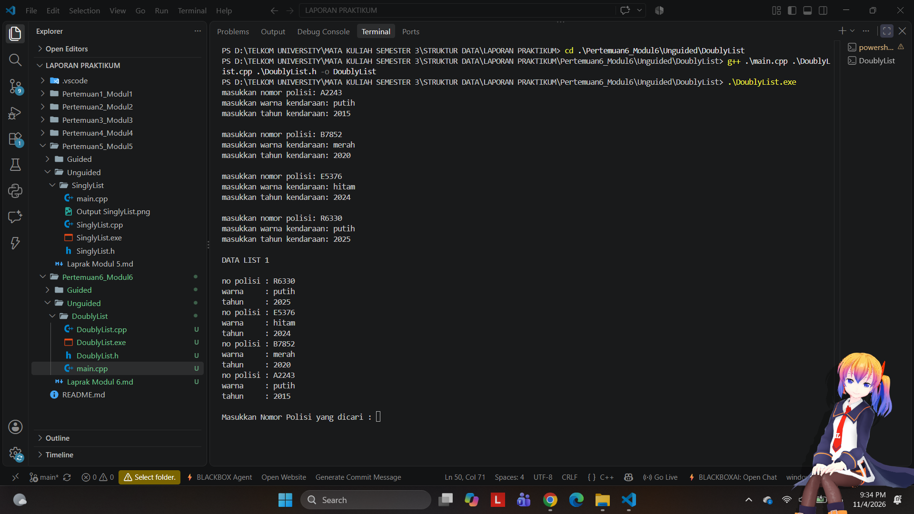
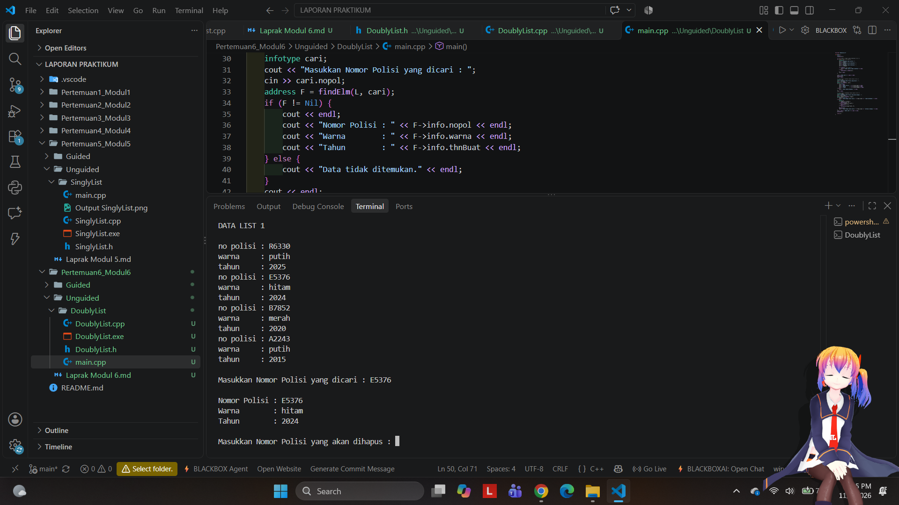
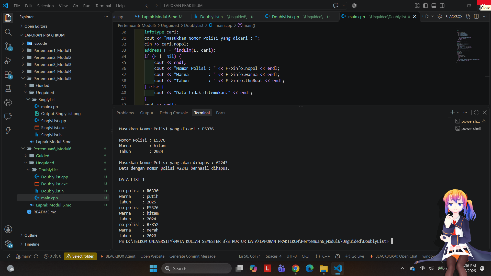

# <h1 align="center">Laporan Praktikum Modul 6 - Doubly Linked List (Bagian Pertama)</h1>
<p align="center">Andhika Nur Pratama - 109082500056</p>

## Dasar Teori
<div align="justify">Doubly Linked List merupakan struktur data linear yang terdiri atas sekumpulan node yang saling terhubung melalui pointer. Setiap node memiliki tiga komponen utama, yaitu info untuk menyimpan data, next untuk menunjuk node berikutnya, dan prev untuk menunjuk node sebelumnya. Struktur ini memungkinkan penelusuran elemen dari dua arah, berbeda dengan Singly Linked List yang hanya memiliki pointer menuju node berikutnya [1][2]. Dalam implementasinya, pointer first digunakan untuk menunjuk elemen pertama, sedangkan last menunjuk elemen terakhir. Doubly Linked List mendukung berbagai operasi, seperti penyisipan (insertion), penghapusan (deletion), pencarian (searching), pembaruan (updating), dan penampilan data (viewing). Operasi penyisipan dapat dilakukan pada awal, akhir, maupun di antara elemen, sedangkan penghapusan dilakukan dengan menyesuaikan hubungan pointer agar struktur list tetap terhubung dengan benar [1]. Penelitian mengenai kompleksitas struktur linked list juga membahas operasi penyisipan, penghapusan, dan pencarian sebagai aspek penting dalam mengevaluasi kinerja struktur data [2]. Keunggulan Doubly Linked List terletak pada kemampuannya melakukan penelusuran maju dan mundur serta mempermudah pengaturan hubungan antar-elemen. Namun, penggunaan dua pointer pada setiap node membutuhkan memori tambahan dan mengharuskan pengelolaan pointer dilakukan secara tepat [1][3]. Dalam bahasa C++, struktur ini dapat direpresentasikan menggunakan struct dan pointer sehingga data dapat dikelola secara dinamis sesuai kebutuhan program.</div>

### A. Insert (Penyisipan Node)<br/>
Insert merupakan operasi untuk menambahkan node baru ke dalam Doubly Linked List dengan tetap menjaga hubungan antar-node melalui pointer next dan prev.
#### 1. Insert First
Menambahkan node baru pada posisi pertama list. Pointer next node baru diarahkan ke node pertama sebelumnya, sedangkan pointer prev node pertama sebelumnya diarahkan ke node baru. Kemudian, first diperbarui agar menunjuk node baru.
#### 2. Insert Last
Menambahkan node baru pada posisi terakhir list. Pointer prev node baru diarahkan ke node terakhir sebelumnya, sedangkan pointer next node terakhir sebelumnya diarahkan ke node baru. Kemudian, last diperbarui.
#### 3. Insert After dan Insert Before

### B. Delete (Penghapusan Node)<br/>
Delete merupakan operasi untuk menghapus node dari Doubly Linked List. Proses penghapusan dilakukan dengan memperbarui pointer pada node yang berdekatan agar list tetap terhubung dengan benar.
#### 1. Delete First
Menghapus node pertama dalam list. Pointer first diperbarui agar menunjuk node berikutnya. Pointer prev pada node pertama yang baru diatur menjadi Nil, sedangkan node yang dihapus dapat dikembalikan atau di-dealokasi.
#### 2. Delete Last
Menghapus node terakhir dalam list. Pointer last diperbarui agar menunjuk node sebelumnya. Pointer next pada node terakhir yang baru diatur menjadi Nil, sedangkan node yang dihapus dapat dikembalikan atau di-dealokasi.
#### 3. Delete After dan Delete Before
Delete After digunakan untuk menghapus node setelah node tertentu, sedangkan Delete Before digunakan untuk menghapus node sebelum node tertentu. Proses ini dilakukan dengan menghubungkan kembali node yang tersisa melalui pointer next dan prev, kemudian menghapus node yang ditentukan.

## Guided 

### 1. DoublyList

```H
#ifndef DOUBLYLIST_H
#define DOUBLYLIST_H
#include <string>
using namespace std;

struct barang {
    string kode;
    string nama;
    int tahun;
};

using infotype = barang;
struct elmlist;
using address = elmlist*;
struct elmlist { infotype info; address prev; address next; };
struct list { address first; address last; };

void CreateList(list &L);
address alokasi(const infotype &x);
void dealokasi(address &P);
void insertFirst(list &L, address P);
void insertLast(list &L, address P);
void insertAfter(list &L, address R, address P);
void insertBefore(list &L, address R, address P);
void printInfo(const list &L);
address findElm(const list &L, const string &kode);
void deleteFirst(list &L, address &P);
void deleteLast(list &L, address &P);
void deleteAfter(list &L, address Prec, address &P);
void deleteBefore(list &L, address succ, address &P);

#endif
```
```C++
#include <iostream>
#include <iomanip>
#include "Doublylist.h"
using namespace std;

void CreateList(list &L) { L.first = nullptr; L.last = nullptr; }

address alokasi(const infotype &x) {
    address P = new elmlist;
    P->info = x;
    P->prev = nullptr; P->next = nullptr;
    return P;
}
void dealokasi(address &P) {
    if (P != nullptr) { delete P; P = nullptr; }
}
void insertFirst(list &L, address P) {
    if (!P) return;
    P->prev = nullptr; P->next = L.first;
    if (L.first) L.first->prev = P;
    else L.last = P;
    L.first = P;
}
void insertLast(list &L, address P) {
    if (!P) return;
    P->next = nullptr; P->prev = L.last;
    if (L.last) L.last->next = P;
    else L.first = P;
    L.last = P;
}

void insertAfter(list &L, address R, address P) {
    if (!R || !P) return;
    P->prev = R;
    P->next = R->next;
    if (R->next) R->next->prev = P;
    else L.last = P;
    R->next = P;
}

void insertBefore(list &L, address R, address P) {
    if (!R || !P) return;
    P->next = R;
    P->prev = R->prev;
    if (R->prev) R->prev->next = P;
    else L.first = P;
    R->prev = P;
}
void printInfo(const list &L) {
    address P = L.first;
    if (!P) {
        cout << "List kosong.\n";
        return;
    }

    cout << "+-----------------------------+\n";
    cout << "| Kode   | Nama       | Tahun |\n";
    cout << "+-----------------------------+\n";
    while (P) {
        cout << "| " << left << setw(6) << P->info.kode
             << " | " << setw(10) << P->info.nama
             << " | " << setw(5) << P->info.tahun << " |\n";
        P = P->next;
    }
    cout << "+-----------------------------+\n";
}
address findElm(const list &L, const string &kode) {
    address P = L.first;
    while (P) {
        if (P->info.kode == kode) return P;
        P = P->next;
    }
    return nullptr;
}
void deleteFirst(list &L, address &P) {
    if (!L.first) { P = nullptr; return; }
    P = L.first; L.first = P->next;
    if (L.first) L.first->prev = nullptr;
    else L.last = nullptr;
    P->prev = P->next = nullptr;
}
void deleteLast(list &L, address &P) {
    if (!L.last) { P = nullptr; return; }
    P = L.last; L.last = P->prev;
    if (L.last) L.last->next = nullptr;
    else L.first = nullptr;
    P->prev = P->next = nullptr;
}
void deleteAfter(list &L, address prec, address &P) {
    P = nullptr;
    if (!prec || !prec->next) return;
    P = prec->next; prec->next = P->next;
    if (P->next) P->next->prev = prec;
    else L.last = prec;
    P->prev = P->next = nullptr;
}
void deleteBefore(list &L, address succ, address &P) {
    P = nullptr;
    if (!succ || !succ->prev) return;
    P = succ->prev; succ->prev = P->prev;
    if (P->prev) P->prev->next = succ;
    else L.first = succ;
    P->prev = P->next = nullptr;
}
```
```C++

#include <iostream>
#include "DoublyList.h"
using namespace std;

void tampilkanJudul(const string &judul) {
    cout << "\n====================================\n";
    cout << judul << '\n';
    cout << "====================================\n";
}

int main() {
    list L;
    CreateList(L);

    infotype barang1 = {"B001", "Laptop", 2020};
    infotype barang2 = {"B002", "Monitor", 2022};
    infotype barang3 = {"B003", "Keyboard", 2023};
    infotype barang4 = {"B004", "Mouse", 2024};

    address P = nullptr;
    address posisi = nullptr;

    cout << "DEMONSTRASI OPERASI DOUBLY LINKED LIST\n";
    cout << "Data yang digunakan: B001, B002, B003, dan B004\n";

    tampilkanJudul("[1] INSERT FIRST");
    cout << "Menambahkan B002 di awal list.\n";
    insertFirst(L, alokasi(barang2));
    printInfo(L);

    tampilkanJudul("[2] INSERT LAST");
    cout << "Menambahkan B004 di akhir list.\n";
    insertLast(L, alokasi(barang4));
    printInfo(L);

    tampilkanJudul("[3] INSERT AFTER");
    cout << "Menambahkan B003 setelah B002.\n";
    posisi = findElm(L, "B002");
    if (posisi != nullptr) {
        insertAfter(L, posisi, alokasi(barang3));
    }
    printInfo(L);

    tampilkanJudul("[4] INSERT BEFORE");
    cout << "Menambahkan B001 sebelum B002.\n";
    posisi = findElm(L, "B002");
    if (posisi != nullptr) {
        insertBefore(L, posisi, alokasi(barang1));
    }
    printInfo(L);

    tampilkanJudul("[5] FIND ELEMENT");
    cout << "Mencari barang dengan kode B003.\n";
    posisi = findElm(L, "B003");
    if (posisi != nullptr) {
        cout << "Data ditemukan:\n";
        cout << "  Kode  : " << posisi->info.kode << '\n';
        cout << "  Nama  : " << posisi->info.nama << '\n';
        cout << "  Tahun : " << posisi->info.tahun << '\n';
    } else {
        cout << "Data tidak ditemukan.\n";
    }

    tampilkanJudul("[6] DELETE AFTER");
    cout << "Menghapus node setelah B002 (B003).\n";
    posisi = findElm(L, "B002");
    deleteAfter(L, posisi, P);
    if (P != nullptr) {
        cout << "Node yang dihapus: " << P->info.kode << '\n';
        dealokasi(P);
    } else {
        cout << "Tidak ada node yang dapat dihapus.\n";
    }
    printInfo(L);

    tampilkanJudul("[7] DELETE BEFORE");
    cout << "Menghapus node sebelum B004 (B002).\n";
    posisi = findElm(L, "B004");
    deleteBefore(L, posisi, P);
    if (P != nullptr) {
        cout << "Node yang dihapus: " << P->info.kode << '\n';
        dealokasi(P);
    } else {
        cout << "Tidak ada node yang dapat dihapus.\n";
    }
    printInfo(L);

    tampilkanJudul("[8] DELETE FIRST");
    cout << "Menghapus node pertama.\n";
    deleteFirst(L, P);
    if (P != nullptr) {
        cout << "Node yang dihapus: " << P->info.kode << '\n';
        dealokasi(P);
    } else {
        cout << "List kosong, tidak ada node yang dapat dihapus.\n";
    }
    printInfo(L);

    tampilkanJudul("[9] DELETE LAST");
    cout << "Menghapus node terakhir.\n";
    deleteLast(L, P);
    if (P != nullptr) {
        cout << "Node yang dihapus: " << P->info.kode << '\n';
        dealokasi(P);
    } else {
        cout << "List kosong, tidak ada node yang dapat dihapus.\n";
    }
    printInfo(L);

    tampilkanJudul("SELESAI");
    cout << "Kondisi list: "
         << (L.first == nullptr && L.last == nullptr
             ? "kosong.\n" : "masih berisi data.\n");

    return 0;
}

```
Program ini mendemonstrasikan semua operasi Doubly Linked List pada data barang: menambah empat barang (B001 sampai B004) dengan insert first, last, after, dan before, mencari satu barang, lalu menghapusnya satu per satu dengan delete after, before, first, dan last sampai list kosong, sambil mencetak isi list di setiap langkah.

## Unguided 

### 1. (Buatlah ADT Doubly Linked list sebagai berikut di dalam file “Doublylist.h”:)

```H
#ifndef DOUBLYLIST_H
#define DOUBLYLIST_H

#include <iostream>
#include <string>
using namespace std;

#define Nil NULL

struct kendaraan {
    string nopol;
    string warna;
    int thnBuat;
};

typedef kendaraan infotype;
typedef struct ElmList *address;

struct ElmList {
    infotype info;
    address next;
    address prev;
};

struct List {
    address First;
    address Last;
};

void CreateList(List &L);
address alokasi(infotype x);
void dealokasi(address &P);
void printInfo(List L);
void insertLast(List &L, address P);

address findElm(List L, infotype x);

void deleteFirst(List &L, address &P);
void deleteLast(List &L, address &P);
void deleteAfter(address Prec, address &P);

#endif
```
```C++
#include "Doublylist.h"

void CreateList(List &L) {
    L.First = Nil;
    L.Last = Nil;
}

address alokasi(infotype x) {
    address P = new ElmList;
    P->info = x;
    P->next = Nil;
    P->prev = Nil;
    return P;
}

void dealokasi(address &P) {
    delete P;
    P = Nil;
}

void printInfo(List L) {
    address P = L.Last;
    while (P != Nil) {
        cout << "no polisi : " << P->info.nopol << endl;
        cout << "warna     : " << P->info.warna << endl;
        cout << "tahun     : " << P->info.thnBuat << endl;
        P = P->prev;
    }
}

void insertLast(List &L, address P) {
    if (L.First == Nil) {     
        L.First = P;
        L.Last = P;
    } else {
        P->prev = L.Last;
        (L.Last)->next = P;
        L.Last = P;
    }
}

address findElm(List L, infotype x) {
    address P = L.First;
    while (P != Nil) {
        if (P->info.nopol == x.nopol) {
            return P;
        }
        P = P->next;
    }
    return Nil;
}

void deleteFirst(List &L, address &P) {
    P = L.First;
    if (P == Nil) return;
    if (L.First == L.Last) {      
        L.First = Nil;
        L.Last = Nil;
    } else {
        L.First = (L.First)->next;
        (L.First)->prev = Nil;
    }
    P->next = Nil;
    P->prev = Nil;
}

void deleteLast(List &L, address &P) {
    P = L.Last;
    if (P == Nil) return;
    if (L.First == L.Last) {     
        L.First = Nil;
        L.Last = Nil;
    } else {
        L.Last = (L.Last)->prev;
        (L.Last)->next = Nil;
    }
    P->next = Nil;
    P->prev = Nil;
}

void deleteAfter(address Prec, address &P) {
    P = Nil;
    if (Prec == Nil || Prec->next == Nil) return;
    P = Prec->next;
    Prec->next = P->next;
    if (P->next != Nil) {
        (P->next)->prev = Prec;
    }
    P->next = Nil;
    P->prev = Nil;
}
```
```C++
#include "Doublylist.h"

int main() {
    List L;
    CreateList(L);

    for (int i = 0; i < 4; i++) {
        infotype x;
        cout << "masukkan nomor polisi: ";
        cin >> x.nopol;
        cout << "masukkan warna kendaraan: ";
        cin >> x.warna;
        cout << "masukkan tahun kendaraan: ";
        cin >> x.thnBuat;

        if (findElm(L, x) != Nil) {
            cout << "nomor polisi sudah terdaftar" << endl;
        } else {
            insertLast(L, alokasi(x));
        }
        cout << endl;
    }

    cout << "DATA LIST 1" << endl << endl;
    printInfo(L);
    cout << endl;
```
### Output Unguided 1 :

##### Output 1


Program yang membuat list kosong, lalu meminta 4 data kendaraan. Setiap data dicek dulu dengan findElm. Kalau nomor polisinya sudah ada, program mencetak “nomor polisi sudah terdaftar”. Kalau belum, data dimasukkan di belakang list dengan insertLast. Terakhir, printInfo mencetak isi list dari belakang ke depan.

### 2. (Carilah elemen dengan nomor polisi D001 dengan membuat fungsi baru.)

```C++
    infotype cari;
    cout << "Masukkan Nomor Polisi yang dicari : ";
    cin >> cari.nopol;
    address F = findElm(L, cari);
    if (F != Nil) {
        cout << endl;
        cout << "Nomor Polisi : " << F->info.nopol << endl;
        cout << "Warna        : " << F->info.warna << endl;
        cout << "Tahun        : " << F->info.thnBuat << endl;
    } else {
        cout << "Data tidak ditemukan." << endl;
    }
    cout << endl;
```

### Output Unguided 2 :

##### Output 2


Setelah list terisi, program meminta nomor polisi yang dicari. findElm menelusuri list dari depan sampai menemukan nomor polisi yang cocok. Kalau ketemu, nomor polisi, warna, dan tahunnya ditampilkan. Kalau tidak, program mencetak “Data tidak ditemukan.”

### 3. (Hapus elemen dengan nomor polisi D003 dengan procedure delete.)

```C++
    infotype hapus;
    cout << "Masukkan Nomor Polisi yang akan dihapus : ";
    cin >> hapus.nopol;
    address target = findElm(L, hapus);
    if (target == Nil) {
        cout << "Data dengan nomor polisi " << hapus.nopol << " tidak ditemukan." << endl;
    } else {
        address P;
        if (target == L.First) {
            deleteFirst(L, P);
        } else if (target == L.Last) {
            deleteLast(L, P);
        } else {
            deleteAfter(target->prev, P);
        }
        dealokasi(P);
        cout << "Data dengan nomor polisi " << hapus.nopol << " berhasil dihapus." << endl;
    }
    cout << endl << "DATA LIST 1" << endl << endl;
    printInfo(L);

    return 0;
}
```

### Output Unguided 3 :

##### Output 3


Setelah list terisi, program meminta nomor polisi yang mau dihapus, lalu mencari elemennya. Kalau elemennya di depan, dipakai deleteFirst. Kalau di belakang, dipakai deleteLast. Kalau di tengah, dipakai deleteAfter pada elemen sebelumnya. Elemen yang sudah dilepas dibuang dari memori dengan dealokasi, lalu list yang tersisa dicetak.

## Kesimpulan
<div align ="justify">Doubly linked list adalah linked list yang tiap elemennya punya dua pointer, yaitu `next` ke elemen sesudahnya dan `prev` ke elemen sebelumnya. List ini punya pointer `First` dan `Last` yang menunjuk elemen pertama dan terakhir, serta dianggap kosong kalau `L.first = Nil`. Karena ada `prev`, list bisa dijelajahi maju dan mundur, sehingga proses mencari, mengubah, dan menampilkan data menjadi lebih mudah daripada singly linked list. Operasi insert (first, last, after, before) dan delete (first, last, after, before) dilakukan dengan mengatur ulang pointer `next` dan `prev` di kedua sisi elemen. Konsekuensinya, pengaturan pointer lebih banyak dan lebih mudah salah, sehingga setiap langkah harus teliti agar list tidak rusak.</div>

## Referensi
[1] Wijoyo, Agung., Lalu Akbar Prayudi, Muhamad Fiqih, Rendi Dwi Santoso, Ricky Tri Setiawan Putra, Teguh Arifin, dan Ahmad Farhan. (2024). “Penggunaan Algoritma Doubly Linked List untuk Insertion dan Deletion.” JRIIN: Jurnal Riset Informatika dan Inovasi, Vol. 1, No. 12, hlm. 1329–1331. Diakses melalui https://jurnalmahasiswa.com/index.php/jriin/article/view/1282
<br>[2] Acharjya, Pinaki Pratim., Santanu Koley, dan Subhabrata Barman. (2020). “Analysis of the Complexity of Various Linked Lists.” Turkish Journal of Computer and Mathematics Education (TURCOMAT), Vol. 11, No. 2, hlm. 886–895. Diakses melalui https://www.turcomat.org/index.php/turkbilmat/article/view/11883.
<br>[3] Dharma, Abdi., dan Hendra Handoko Syahputra Pasaribu. (2017). “Aplikasi Pembelajaran Linked List Berbasis Mobile Learning.” Riau Journal of Computer Science, Vol. 4, No. 1, hlm. 1–11. Diakses melalui https://www.researchgate.net/publication/322594022_Aplikasi_Pembelajaran_Linked_List_Berbasis_Mobile_Learning