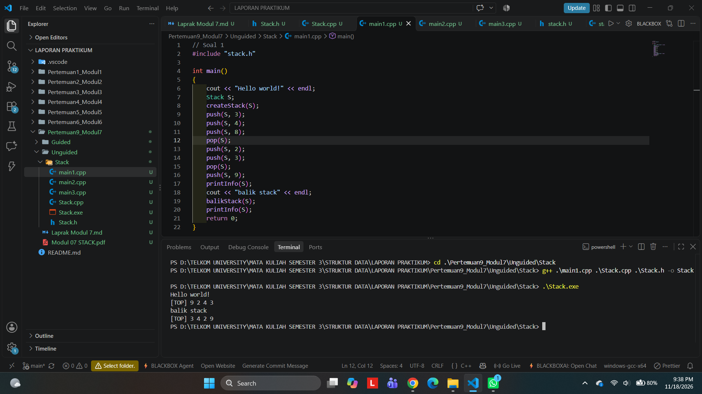
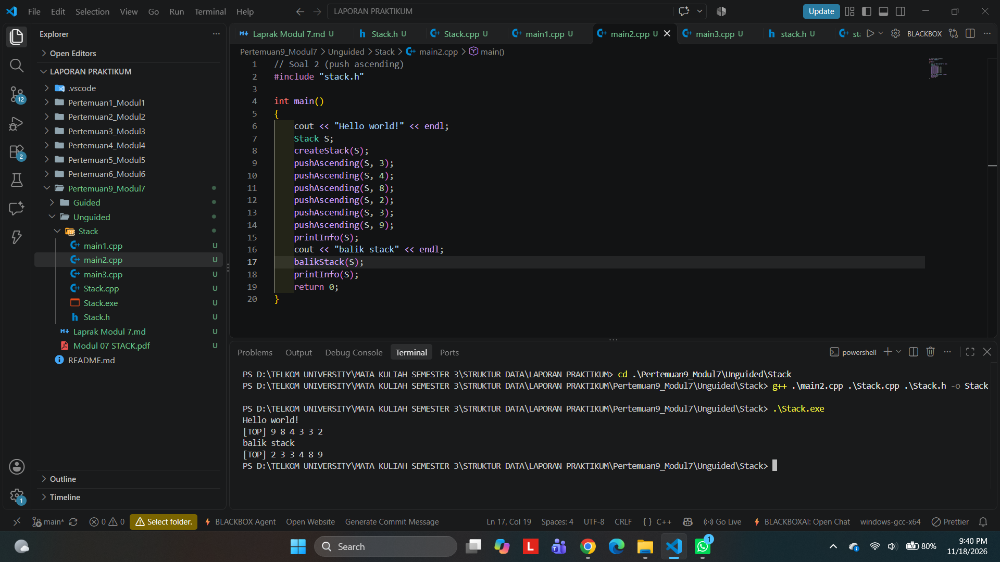
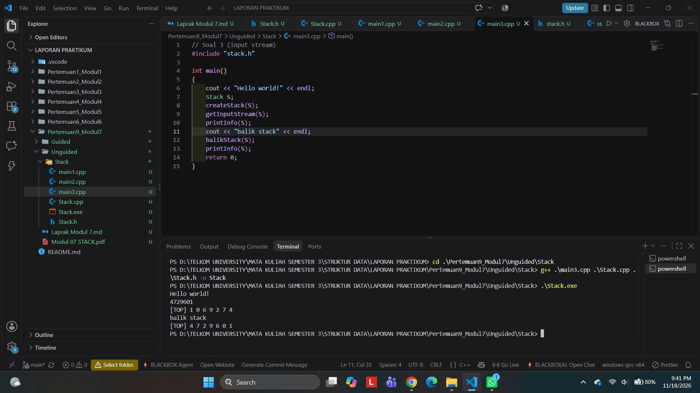

# <h1 align="center">Laporan Praktikum Modul 7 - Stack</h1>
<p align="center">Andhika Nur Pratama - 109082500056</p>

## Dasar Teori
<div align="justify">Stack atau tumpukan merupakan salah satu struktur data linear yang menyimpan sekumpulan data dengan menerapkan prinsip LIFO (Last In, First Out), yaitu data yang terakhir dimasukkan akan menjadi data pertama yang dikeluarkan. Stack memiliki bagian khusus yang disebut top untuk menunjukkan posisi elemen paling atas. Proses penambahan data disebut push, sedangkan proses penghapusan data disebut pop. Struktur data stack dapat diimplementasikan menggunakan array maupun linked list dan dimanfaatkan dalam berbagai aplikasi, seperti fitur undo-redo, pengelolaan riwayat aktivitas, serta pemrosesan ekspresi matematika [1][2].</div>

### A. Pengertian Stack<br/>
Stack merupakan struktur data linear yang menggunakan prinsip LIFO (Last In, First Out), yaitu elemen yang terakhir dimasukkan akan menjadi elemen pertama yang dikeluarkan. Stack memiliki bagian teratas yang disebut top sebagai penunjuk posisi elemen paling atas [1].
#### 1. Prinsip LIFO
Prinsip LIFO merupakan aturan utama dalam Stack, yaitu data yang terakhir masuk akan menjadi data pertama yang keluar.
#### 2. Elemen Top
Top merupakan penanda posisi elemen paling atas dalam Stack yang menjadi tempat berlangsungnya operasi penambahan dan penghapusan data.
#### 3. Karakteristik Stack
Stack hanya memungkinkan penambahan dan penghapusan elemen melalui satu sisi, yaitu bagian atas tumpukan.

### B. Operasi Dasar Stack<br/>
Operasi dasar Stack merupakan proses yang digunakan untuk mengelola elemen data, mulai dari penambahan, penghapusan, hingga pemeriksaan kondisi tumpukan [2].
#### 1. Push
Push merupakan operasi untuk menambahkan elemen baru ke bagian paling atas Stack.
#### 2. Pop
Pop merupakan operasi untuk menghapus elemen yang berada pada posisi paling atas Stack.
#### 3. Peek (Top)
Peek merupakan operasi untuk melihat nilai elemen paling atas tanpa menghapus elemen tersebut dari Stack.

### C. Implementasi Stack<br/>
Stack dapat diterapkan menggunakan beberapa metode penyimpanan data, seperti array dan linked list. Kedua metode tersebut memiliki karakteristik berbeda dalam pengelolaan kapasitas dan penggunaan memori [1].
#### 1. Stack Menggunakan Array
Implementasi Stack menggunakan array menyimpan elemen pada indeks yang berurutan dengan variabel top sebagai penunjuk elemen teratas.
#### 2. Stack Menggunakan Linked List
Implementasi Stack menggunakan linked list memanfaatkan node yang saling terhubung melalui pointer sehingga ukuran Stack dapat menyesuaikan kebutuhan memori.
#### 3. Perbedaan Implementasi
Array memiliki kapasitas yang ditentukan sejak awal, sedangkan linked list memungkinkan penambahan elemen secara dinamis selama memori tersedia.

## Guided 

### 1. Stack

```H
#ifndef STACK_H_INCLUDED
#define STACK_H_INCLUDED
#include <iostream>
using namespace std;

struct infotype {
    char nim[20];
    char nama[20];
};

struct Stack {
    infotype info[10];
    int Top;
};

int isEmpty(Stack S);

void createStack(Stack &S);

void push(Stack &S, infotype X);

void pop(Stack &S, infotype &X);

void viewStack(Stack S);

#endif // STACK_H_INCLUDED
```
```C++
#include <iostream>
#include "cstring"
#include "stack.h"
using namespace std;

int main() {
    Stack S;
    infotype data, hasil;

    createStack(S);
    cout << "Stack baru dibuat, TOP = " << endl;
    viewStack(S);

    cout << "--- Push 3 Data ---" << endl;
    strcpy(data.nim, "103112400001");
    strcpy(data.nama, "Andi");
    push(S, data);

    strcpy(data.nim, "103112400002");
    strcpy(data.nama, "Budi");
    push(S, data);

    strcpy(data.nim, "103112400003");
    strcpy(data.nama, "Citra");
    push(S, data);
}
```
```C++
#include <iostream>
#include <cstring>
#include "stack.h"
using namespace std;

int main() {
    Stack S;
    infotype data, hasil;

    createStack(S);
    cout << "Stack baru dibuat, TOP = " << S.Top << endl;
    viewStack(S);

    cout << endl << "--- Push 3 Data ---" << endl;
    strcpy(data.nim, "103112400001");
    strcpy(data.nama, "Andi");
    push(S, data);

    strcpy(data.nim, "103112400002");
    strcpy(data.nama, "Budi");
    push(S, data);

    strcpy(data.nim, "103112400003");
    strcpy(data.nama, "Citra");
    push(S, data);
    viewStack(S);

    cout << endl << "--- Pop 1 Data ---" << endl;
    pop(S, hasil);
    cout << "Data yang diambil: " << hasil.nim << " - " << hasil.nama << endl;
    viewStack(S);

    cout << endl << "--- Pop sampai kosong ---" << endl;
    pop(S, hasil);
    pop(S, hasil);
    viewStack(S);

    return 0;
}
```
penjelasan singkat guided 1

## Unguided 

### 1. (Buatlah implementasi ADT Stack menggunakan Array pada file “stack.cpp” dan “main.cpp”)

```H
#ifndef STACK_H_INCLUDED
#define STACK_H_INCLUDED

#include <iostream>
using namespace std;

#define MAX 20

typedef int infotype;

struct Stack {
    infotype info[MAX];
    int top;            // -1 berarti stack kosong
};

void createStack(Stack &S);
void push(Stack &S, infotype x);
infotype pop(Stack &S);
void printInfo(Stack S);
void balikStack(Stack &S);

// Soal 2
void pushAscending(Stack &S, infotype x);

// Soal 3
void getInputStream(Stack &S);

#endif // STACK_H_INCLUDED
```
```C++
#include "stack.h"

void createStack(Stack &S) {
    S.top = -1;
}

void push(Stack &S, infotype x) {
    if (S.top < MAX - 1) {
        S.top++;
        S.info[S.top] = x;
    } else {
        cout << "Stack penuh!" << endl;
    }
}

infotype pop(Stack &S) {
    if (S.top >= 0) {
        infotype x = S.info[S.top];
        S.top--;
        return x;
    }
    cout << "Stack kosong!" << endl;
    return -1;
}

void printInfo(Stack S) {
    cout << "[TOP] ";
    for (int i = S.top; i >= 0; i--) {
        cout << S.info[i] << " ";
    }
    cout << endl;
}

void balikStack(Stack &S) {
    // tukar elemen paling bawah dengan paling atas, dst.
    int i = 0;
    int j = S.top;
    while (i < j) {
        infotype temp = S.info[i];
        S.info[i] = S.info[j];
        S.info[j] = temp;
        i++;
        j--;
    }
}

void pushAscending(Stack &S, infotype x) {
    // stack bantu untuk menampung elemen yang lebih besar dari x
    Stack temp;
    createStack(temp);

    while (S.top >= 0 && S.info[S.top] > x) {
        push(temp, pop(S));
    }
    push(S, x);
    while (temp.top >= 0) {
        push(S, pop(temp));
    }
}

void getInputStream(Stack &S) {
    char c;
    c = cin.get();
    while (c != '\n') {
        if (c >= '0' && c <= '9') {
            push(S, c - '0');   // ubah karakter angka jadi integer
        }
        c = cin.get();
    }
}
```
```C++
// Soal 1
#include "stack.h"

int main()
{
    cout << "Hello world!" << endl;
    Stack S;
    createStack(S);
    push(S, 3);
    push(S, 4);
    push(S, 8);
    pop(S);
    push(S, 2);
    push(S, 3);
    pop(S);
    push(S, 9);
    printInfo(S);
    cout << "balik stack" << endl;
    balikStack(S);
    printInfo(S);
    return 0;
}
```
### Output Unguided 1 :

##### Output 


Program ini membuat stack dari array berukuran 20 dengan variabel top sebagai penunjuk elemen paling atas. Saat stack kosong, top = -1. push menaikkan top lalu mengisi data di posisi itu, sedangkan pop mengambil data di top lalu menurunkan top. printInfo mencetak isi stack dari atas ke bawah. balikStack membalik urutan dengan menukar elemen paling bawah dengan yang paling atas, lalu bergerak ke tengah. Di main, urutannya adalah push 3, 4, 8, pop (8 keluar), push 2, 3, pop (3 keluar), lalu push 9. Isi akhirnya 3, 4, 2, 9, jadi tercetak 9 2 4 3 dan setelah dibalik 3 4 2 9.

### 2. (Tambahkan prosedur pushAscending( in/out S : Stack, in x : integer))

```C++
// Soal 2 (push ascending)
#include "stack.h"

int main()
{
    cout << "Hello world!" << endl;
    Stack S;
    createStack(S);
    pushAscending(S, 3);
    pushAscending(S, 4);
    pushAscending(S, 8);
    pushAscending(S, 2);
    pushAscending(S, 3);
    pushAscending(S, 9);
    printInfo(S);
    cout << "balik stack" << endl;
    balikStack(S);
    printInfo(S);
    return 0;
}
```
### Output Unguided 2 :

##### Output 


Prosedur ini memasukkan angka ke stack sambil menjaga urutan, dengan elemen terbesar selalu di atas. Caranya, semua elemen di atas yang lebih besar dari x dipindahkan dulu ke stack bantu (temp). Setelah itu x di-push, lalu elemen di temp dikembalikan ke stack utama. Hasilnya stack selalu terurut, sehingga outputnya 9 8 4 3 3 2 dan setelah dibalik 2 3 3 4 8 9.

### 3. (Tambahkan prosedur getInputStream( in/out S : Stack ). Prosedur akan terus membaca dan menerima input user dan memasukkan setiap input ke dalam stack hingga user menekan tombol enter. Contoh: gunakan cin.get() untuk mendapatkan inputan user.)

```C++
// Soal 3 (input stream)
#include "stack.h"

int main()
{
    cout << "Hello world!" << endl;
    Stack S;
    createStack(S);
    getInputStream(S);
    printInfo(S);
    cout << "balik stack" << endl;
    balikStack(S);
    printInfo(S);
    return 0;
}
```
### Output Unguided 3 :

##### Output


Prosedur ini membaca input satu karakter demi satu dengan cin.get() dan berhenti saat user menekan Enter. Setiap karakter angka diubah menjadi bilangan dengan c - '0' (misalnya karakter '4' menjadi 4), lalu di-push ke stack. Karena stack bersifat LIFO, input 4729601 tercetak dari atas sebagai 1 0 6 9 2 7 4, dan setelah dibalik menjadi 4 7 2 9 6 0 1.

## Kesimpulan
<div align="justify">Stack adalah struktur data dengan prinsip LIFO (Last In First Out), yaitu elemen yang terakhir masuk adalah yang pertama keluar, dan semua akses hanya lewat satu pintu bernama TOP dengan dua operasi utama, push (menambah) dan pop (mengambil). Stack bisa dibuat dengan pointer, yang ukurannya fleksibel tapi perlu mengatur memori, atau dengan array, yang ukurannya terbatas tapi lebih sederhana karena cukup mengatur variabel `top`. Dari latihan terbukti bahwa data yang masuk akan keluar dalam urutan terbalik (input `4729601` tercetak `1 0 6 9 2 7 4`), bahwa untuk menyisipkan elemen secara berurutan kita butuh stack bantu karena akses hanya bisa dari atas, dan bahwa stack bisa dibalik dengan menukar elemen dari ujung ke ujung. Aturan akses yang ketat inilah yang membuat stack berguna untuk kasus yang butuh urutan "terakhir masuk, pertama keluar", seperti membalik data, fitur undo, dan pemeriksaan kurung.</div>

## Referensi
[1] S. Amaylia et al. (2025). Application of Stack Data Structure in Application Development. Journal of Advanced Systems Intelligence and Cybersecurity.
<br>[2] R. A. Ramadhan dan I. H. Ikasari. Penerapan Struktur Data Stack untuk Implementasi Fitur Undo pada Aplikasi Sederhana: Literature Review.
<br>...
